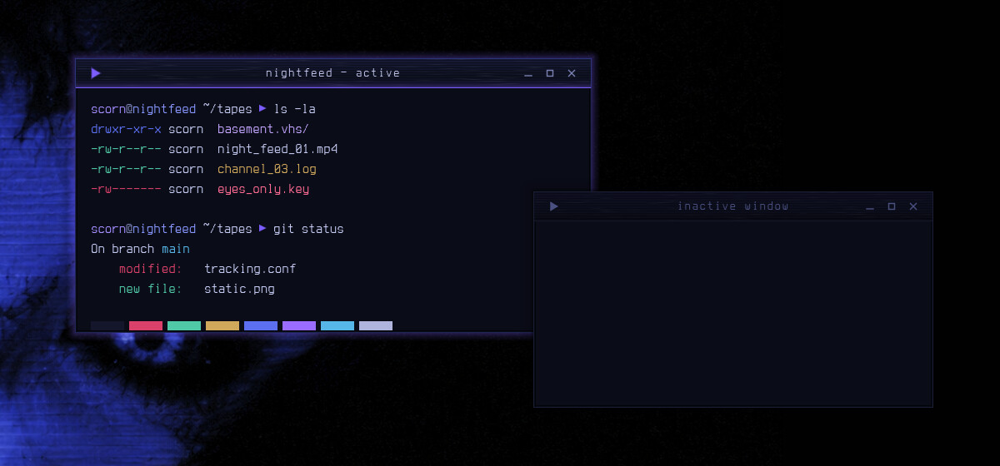
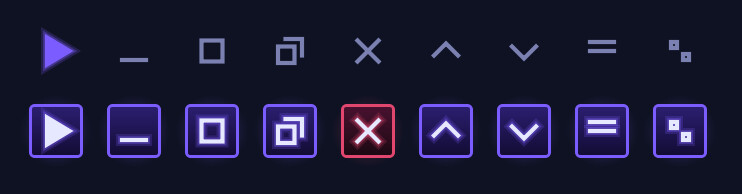

# Nightfeed — Aurorae Window Decoration

A cobalt-black VHS window frame: a scanline title bar with tape-grain streaks, a violet glow seam, a violet-glow shadow and VCR transport buttons.



Nightfeed is a night-vision VHS look for KDE Plasma 6, built around a cobalt-lit face on near-black: cobalt-black surfaces, faint scanlines and tape grain, and a slight violet glow on whatever has focus.

## Features

- Title bar with faint scanlines and tape grain that stretches into horizontal VHS streaks.
- A violet glow seam under the title, with a hot 1 px core.
- The active window casts a soft violet glow; inactive windows dim to cobalt-black with a plain shadow.
- Square transport-style buttons that light up violet on hover (close glows REC red). The window-menu button is a VCR `▶ PLAY` triangle.
- Centred title, 3 px borders, no rounded corners.



## Requirements

KWin (Plasma 6) with Aurorae.

## Install

```bash
git clone https://github.com/numbpill3d/nightfeed-aurorae
cd nightfeed-aurorae && ./install.sh
```

Or from the KDE Store: System Settings → Colors & Themes → Window Decorations → Install from File, or extract to `~/.local/share/aurorae/themes/`.

## The rest of the suite

| piece | repo |
|---|---|
| SDDM login | [nightfeed-sddm](https://github.com/numbpill3d/nightfeed-sddm) |
| Plymouth boot splash | [nightfeed-plymouth](https://github.com/numbpill3d/nightfeed-plymouth) |
| Global theme + splash screen | [nightfeed-global](https://github.com/numbpill3d/nightfeed-global) |
| Plasma style (panel, popups) | [nightfeed-plasma](https://github.com/numbpill3d/nightfeed-plasma) |
| Colour scheme | [nightfeed-colors](https://github.com/numbpill3d/nightfeed-colors) |
| Kvantum widget style | [nightfeed-kvantum](https://github.com/numbpill3d/nightfeed-kvantum) |
| Icon theme | [nightfeed-icons](https://github.com/numbpill3d/nightfeed-icons) |
| Konsole + kitty colours | [nightfeed-konsole](https://github.com/numbpill3d/nightfeed-konsole) |

Everything at once, with the generators: [nightfeed](https://github.com/numbpill3d/nightfeed).

## Tags

`nightfeed` `kde` `plasma6` `dark` `vhs` `scanlines` `cobalt` `violet` `purple` `retro` `analog-horror` `glow` `aurorae` `window-decoration` `kwin` `titlebar` `vcr-buttons`

## Credits and licence

By splicer scorn (voidrane). GPL-3.0-or-later.
